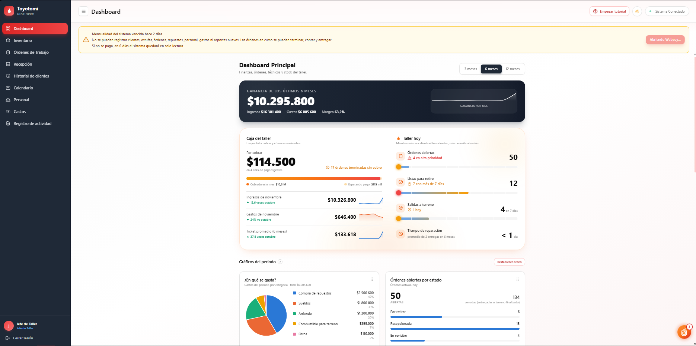
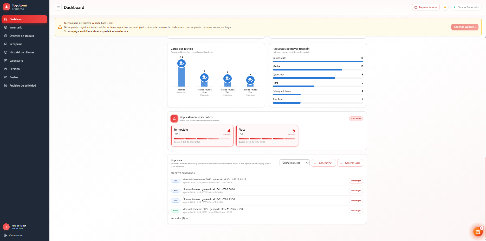
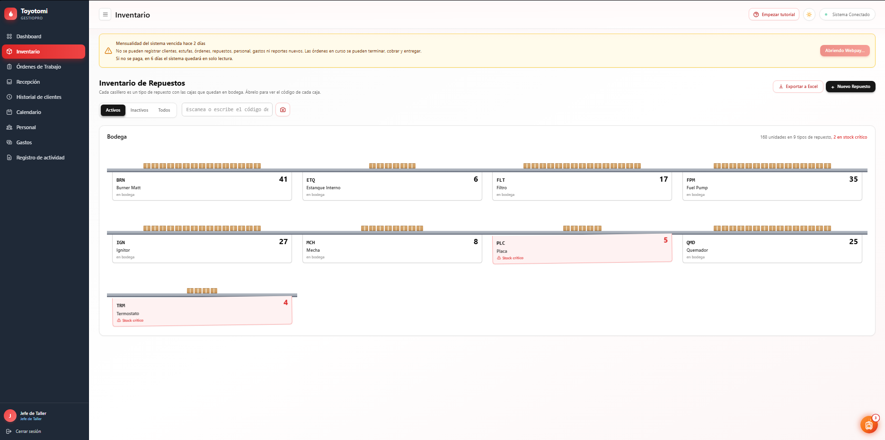
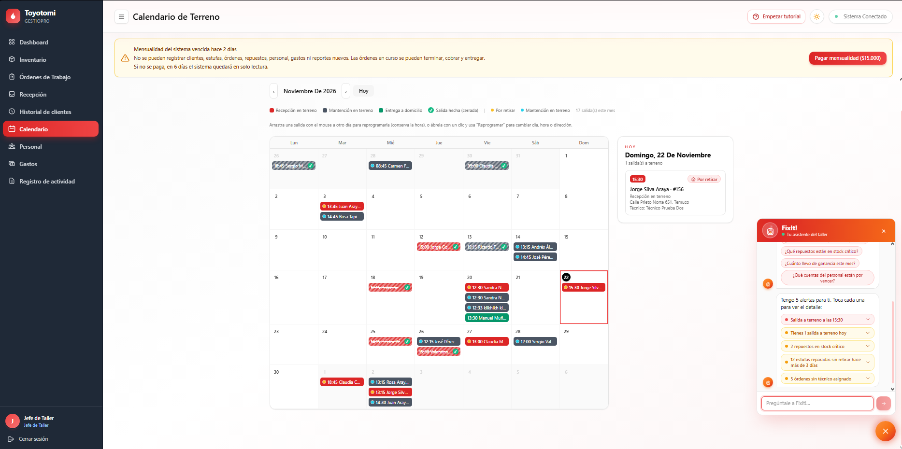
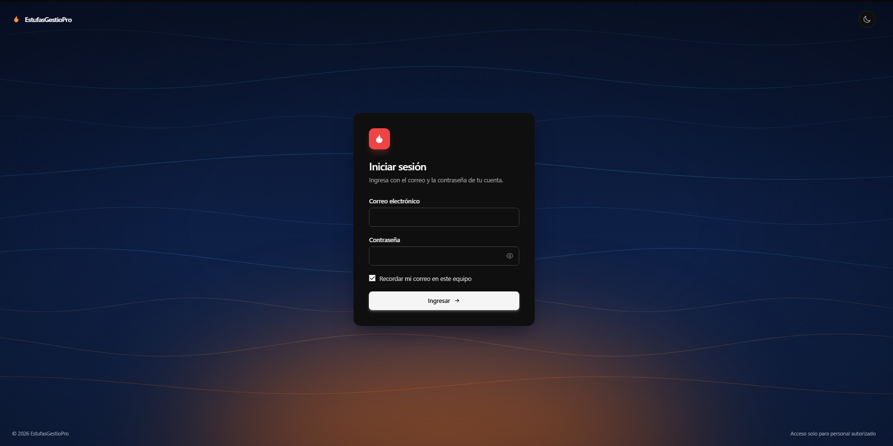

# Hola, soy Joaquín Silva

Estudiante de **Ingeniería en Informática** en **INACAP Temuco** (egreso 2026). Desarrollador Full Stack con interés en **ingeniería de datos** e **inteligencia artificial**.

- Busco mi **Práctica Profesional** en desarrollo de software y datos.
- Desarrollé un **SaaS para empresas de calefacción y climatización** que digitaliza inventario, órdenes de servicio y pagos de un taller con cerca de 230 clientes al mes.
- Estoy aprendiendo ingeniería de datos (Python, pandas, ETL) e inglés nivel B2 en Wall Street English.
- Contacto: [joacoalejandro35@gmail.com](mailto:joacoalejandro35@gmail.com) · [LinkedIn](https://www.linkedin.com/in/joaquin-silva-991a02398/)

## Tecnologías

**Lenguajes**

**Frameworks**

**Bases de datos**

**Nube y herramientas**

## Proyectos destacados

### EstufasGestioPro

Plataforma SaaS para talleres de calefacción y climatización: inventario de repuestos, órdenes de trabajo, recepción de equipos, pagos online con Webpay y reportes en PDF y Excel.

| Dashboard | Dashboard (finanzas) |
| --- | --- |
|  |  |
| **Inventario** | **Órdenes de Trabajo** |
|  |  |
| **Calendario** | **Login** |
|  |  |

### Otros proyectos

| Proyecto | Descripción | Stack |
| --- | --- | --- |
| [**Cofrial**](https://github.com/shaskw01/cofrial) | Solución de transformación digital desplegada en 2 instancias AWS EC2 con Docker. | Django REST · React · PostgreSQL · AWS |
| **Asistente de IA local** | Asistente de inteligencia artificial en local con interfaz web, enfocado en ciberseguridad. | Python · IA |

## Estadísticas

